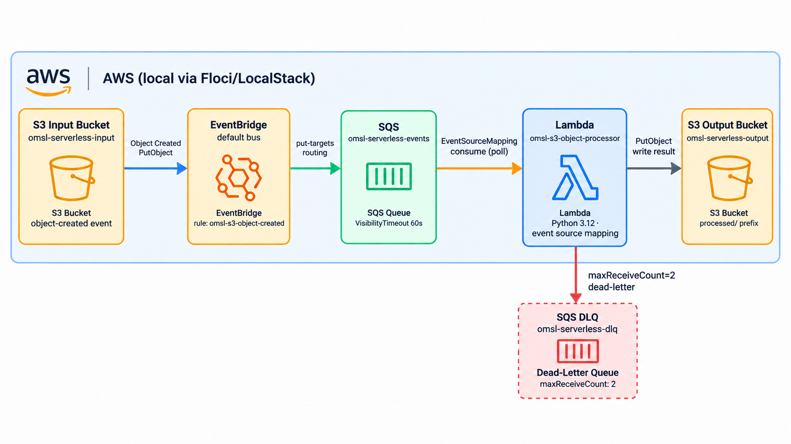
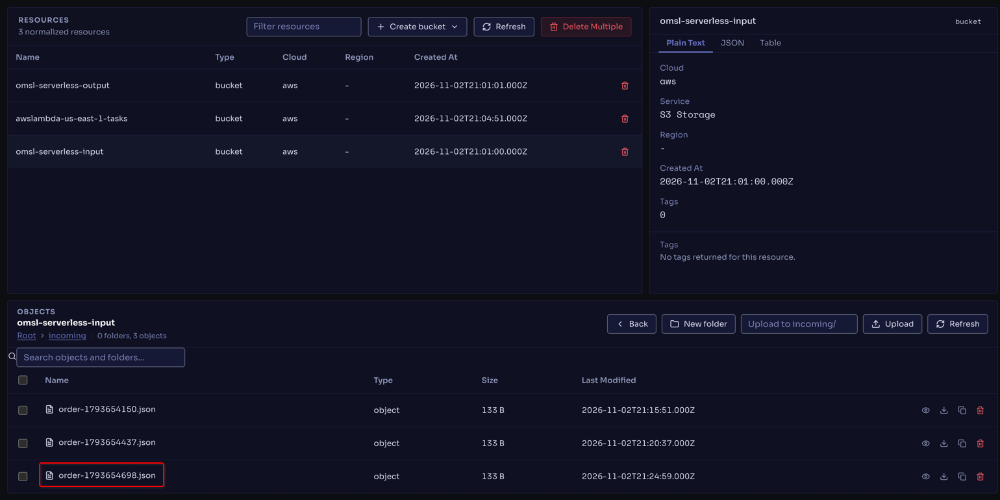
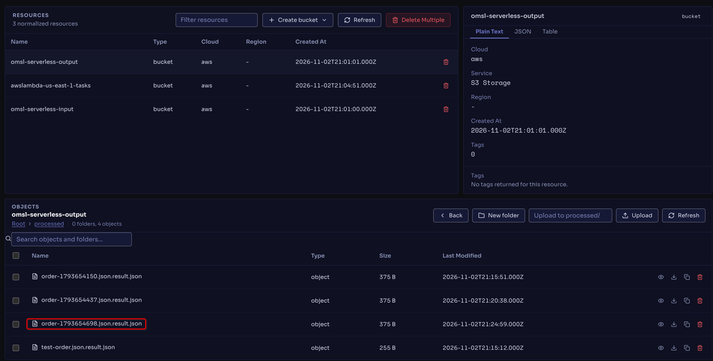
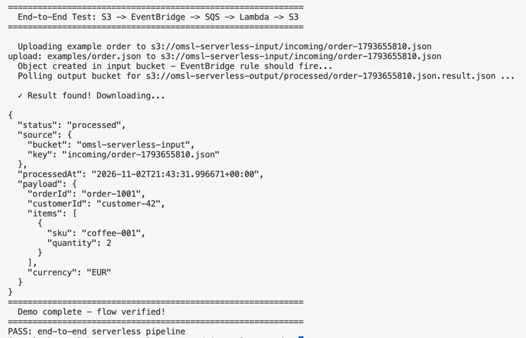
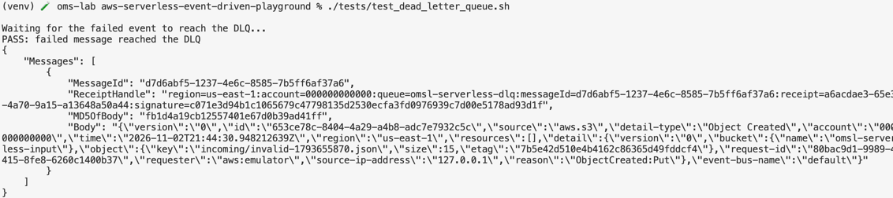

<p align="center">
  
</p>

<h1 align="center">AWS Serverless Event-Driven Playground</h1>

<p align="center">

A reproducible local experiment demonstrating an event-driven file-processing pipeline with Amazon S3, EventBridge, SQS and Lambda, using Floci as the AWS emulator.

This repository is an educational playground. It is not a production-ready platform.

</p>

<p align="center">

[](LICENSE)
[](https://floci.io/aws/)
[](https://www.python.org/)

</p>

## 🧭 Overview

This playground follows an object from upload to processing without requiring an AWS account:

1. A JSON file is uploaded to an input S3 bucket.
2. S3 publishes object-created events to Amazon EventBridge.
3. An EventBridge rule filters events for the input bucket and sends them to an SQS queue.
4. A Lambda function consumes the SQS message, reads the original object and writes a processing result to a second S3 bucket.
5. Failed messages can be moved to a dead-letter queue (DLQ) after repeated receives.

Floci provides the local AWS-compatible endpoint. Lambda code runs in Docker-managed runtime containers; the other services are emulated by Floci.


## 🏗️ Architecture
<p align="center">
  
</p>

## 🎯 Objective

Explore event routing, queue-based decoupling, Lambda event source mappings, object storage, retries and dead-letter handling through a single reproducible scenario.

## 🧩 Components

| Component | Responsibility |
|---|---|
| Floci | Local AWS-compatible API endpoint on port `4566` |
| S3 input bucket | Stores uploaded JSON documents and emits object-created events to EventBridge |
| EventBridge | Filters S3 object-created events and routes matching events to SQS |
| SQS processing queue | Buffers events for Lambda |
| SQS dead-letter queue | Receives messages after the configured receive limit |
| Lambda | Reads the source object and writes a processing result |
| S3 output bucket | Stores processed JSON documents |
| AWS CLI | Creates resources, uploads input and verifies output |

## 📋 Prerequisites

- Docker Engine and Docker Compose plugin.
- AWS CLI v2.
- `zip`, `curl`, and Python 3 on the host for the bootstrap script.
- Internet access on first run to pull Floci and the Lambda runtime image.

Keep Docker running during the demo. Lambda is executed in Docker-managed runtime containers.

## 📦 Installation

```bash
git clone https://github.com/openmind-systems-lab/aws-serverless-event-driven-playground.git
cd aws-serverless-event-driven-playground
docker compose up -d
```

Configure local AWS CLI credentials:

```bash
export AWS_ENDPOINT_URL=http://localhost:4566
export AWS_DEFAULT_REGION=us-east-1
export AWS_ACCESS_KEY_ID=test
export AWS_SECRET_ACCESS_KEY=test
```

These are local placeholder credentials, not AWS credentials.

## 🚀 Quick Start / Deployment

```bash
./scripts/bootstrap.sh
```

The script creates the buckets, queues, EventBridge rule and target, Lambda execution role, function, and SQS event source mapping. It packages the Lambda function locally.

| S3 Input Bucket | 
|-----------------|
|  |

| S3 Output Bucket |
|-----------------|
|   |

## 🔎 Verification

```bash
./scripts/demo.sh
```

The demo uploads `examples/order.json`, waits for the processed object, and prints its contents. The result is stored under `processed/` in `omsl-serverless-output`.

Inspect the output bucket:

```bash
aws --endpoint-url "$AWS_ENDPOINT_URL" s3api list-objects-v2 \
  --bucket omsl-serverless-output
```

## 🧪 Testing

Run the end-to-end happy path:

```bash
./tests/test_pipeline.sh
```

| Pipeline Test Pass | 
|--------------------|
|  |

Run the optional failure-path experiment:

```bash
./tests/test_dead_letter_queue.sh
```

| Dead-Letter Queue |
|--------------------|
|   |


The failure test uploads invalid JSON. The Lambda handler reports the failed SQS record, allowing the queue redrive policy to retry it and eventually move it to the DLQ. This test can take a few minutes.


## 🎬 Demo

Watch the full end-to-end flow (S3 → EventBridge → SQS → Lambda → S3):

<video src="https://github.com/user-attachments/assets/45fd7382-ed14-4c9c-8679-7c821fe52399" controls width="700"></video>

1. Start Floci.
2. Deploy the resources.
3. Upload a JSON order.
4. Observe the EventBridge → SQS → Lambda path.
5. Read the processed object from the output bucket.
6. Optionally test a malformed document and inspect the DLQ.

## 🧠 What You Will Learn

- S3 object-created event delivery to EventBridge.
- EventBridge event pattern filtering.
- Queue-based decoupling with SQS.
- Lambda event source mappings.
- Partial batch failure reporting.
- Retry and dead-letter queue behavior.

## 🧹 Cleanup

```bash
./scripts/cleanup.sh
docker compose down -v
```

The cleanup script removes the resources created by this playground.

## 📚 References

- [Floci – AWS local emulator](https://floci.io/aws/)
- [Floci GitHub repository](https://github.com/floci-io/floci)
- [Floci S3 service documentation](https://floci.io/floci/services/s3/)
- [Floci Lambda service documentation](https://floci.io/floci/services/lambda/)
- [Amazon S3 EventBridge notifications](https://docs.aws.amazon.com/AmazonS3/latest/userguide/enable-event-notifications-eventbridge.html)
- [Amazon EventBridge event patterns](https://docs.aws.amazon.com/eventbridge/latest/userguide/eb-event-patterns.html)
- [Amazon SQS dead-letter queues](https://docs.aws.amazon.com/AWSSimpleQueueService/latest/SQSDeveloperGuide/sqs-dead-letter-queues.html)
- [AWS Lambda with Amazon SQS](https://docs.aws.amazon.com/lambda/latest/dg/with-sqs.html)
- [AWS CLI v2 documentation](https://docs.aws.amazon.com/cli/latest/userguide/cli-chap-welcome.html)
- [Python 3.12](https://docs.python.org/3.12/)

## 🏛 About OpenMind Systems Lab

OpenMind Systems Lab is an independent French non-profit association dedicated to research, experimental development and technical benchmarking in Cloud Native technologies.

Our mission is to produce practical, reproducible and educational Open Source Proofs of Concept covering Kubernetes, Platform Engineering, Distributed Messaging, Infrastructure Security and Artificial Intelligence.

GitHub Organization:

https://github.com/openmind-systems-lab

---

<p align="center">
Made with ❤️ by OpenMind Systems Lab
</p>
